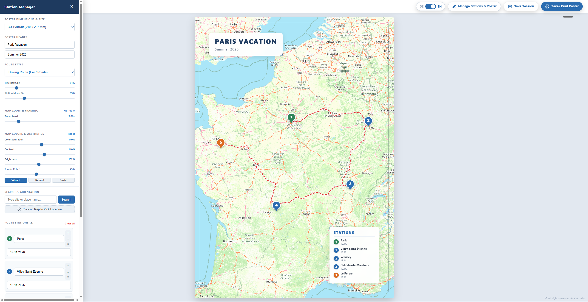

# 🗺️ Travel Poster Creator

<p align="center">
  <strong>A high-performance, interactive web studio for designing, styling, and printing elegant, high-resolution road trip maps and personalized travel posters.</strong>
</p>

<p align="center">
  <a href="https://travelpostercreator.vercel.app/"><strong>Explore the Live Studio »</strong></a>
</p>

<p align="center">
  
  
  
  
  
  
  
</p>

<p align="center">
  
</p>

---

## 💡 Why Travel Poster Creator?

Commercial map print services and custom poster generators often come with frustrating limitations:
- **Steep costs & paywalls**: Commercial poster services charge heavy markups for simple static map prints.
- **Rigid, inflexible templates**: Most map makers draw straight lines between points rather than actual driving routes, ignoring the true curves, highways, and bridges of your road trip.
- **Cluttered markers & overlapping lines**: Return routes often completely obscure outbound journeys, and generic map markers blot out city names and coastal borders.
- **Zero real-time visual control**: You are stuck with fixed color palettes with no ability to tune saturation, contrast, topographic hillshading, or frame scaling on the fly.

**Travel Poster Creator** solves all of this:
1. **100% In-Browser & Free**: Everything runs client-side with zero account sign-ups, subscriptions, watermarks, or hidden paywalls.
2. **Authentic Road Trip Geometry**: Computes authentic turn-by-turn car routes via the Open Source Routing Machine (OSRM), complete with ferry detection and smart leg-offsetting algorithms so round trips never merge into a single confusing line.
3. **Studio-Grade Aesthetic & Typography Controls**: Real-time post-processing filters (Saturation, Contrast, Brightness, Topographic Relief) applied strictly to the map canvas, combined with interactive drag-to-resize title cards, customizable station legends, and elegant teardrop balloon pins.
4. **Print-Ready Export**: Export high-resolution posters in standard dimensions (**A3**, **A4**, **A5**, or **Square**) with dedicated print styling that strips away UI chrome and delivers clean, bleed-to-edge PDFs.
5. **Full Bilingual Studio**: Use the entire application in either **English** or **German** with an instant one-click toggle.

---

## 🚀 Key Features

### 🛣️ Turn-by-Turn Driving Routing (OSRM)
- **Authentic Road Trip Paths**: Automatically plots genuine driving paths across motorways, scenic mountain passes, coastal bridges, and country highways powered by the Open Source Routing Machine (OSRM).
- **Intelligent Leg Offsetting**: Employs normal-vector coordinate offsetting (`offsetLeg`) on overlapping road segments so return journeys remain clearly visible alongside outbound legs.
- **Ferry & Sea Crossing Detection**: Accurately recognizes and renders ferry transit legs between islands and international borders.
- **Dual Routing Modes**: Toggle instantly between **Driving Route** (road navigation) and **Direct Line** (air distance beeline) modes.

### 🎨 Real-Time Map Aesthetics & Color Grading
- **Live Post-Processing Sliders**: Fine-tune **Saturation**, **Contrast**, **Brightness**, and **Relief / Terrain (Esri Hillshade)** in real time.
- **Instant Aesthetic Presets**:
  - 🌟 **Vibrant**: Rich color saturation and elevated contrast for lively vacation posters.
  - 🌿 **Natural**: Balanced, true-to-life tones for classical cartography.
  - 🌸 **Pastel**: Muted tones with soft contrast for modern Scandinavian wall decor.
- **Non-Destructive Filtering**: Color shaders apply exclusively to the base tile layers, ensuring markers, text labels, polyline strokes, and legend elements remain razor sharp.

### 📍 Station Management & Smart Markers
- **Elevated Teardrop Balloon Pins**: Custom SVG map markers with pointer tails designed to highlight exact coordinates without obscuring city labels or terrain.
- **Global Location Search**: Instant search for cities, regions, and landmarks across the globe via the Nominatim Geocoding API.
- **Interactive Map Pinning**: Click directly anywhere on the map to drop a new waypoint with automatic geocoded coordinates.
- **Dynamic Sequence Reordering**: Reorder itinerary stops using `↑` and `↓` buttons with automatic sequential number updates across pins, legend badges, and drawer lists.
- **Date Integration**: Assign custom stay durations per station using integrated [Flatpickr](https://flatpickr.js.org/) date range calendars.

### 📐 Interactive Layout & Drag-to-Resize Studio
- **Direct Visual Resizing**: Drag handles on the **Title Card**, **Station Legend Box**, and **Sidebar Drawer** for intuitive manual resizing directly on screen.
- **Live Scale Sliders**: Adjust Title Box scale (70% – 160%) and Legend Box scale (70% – 140%) with live percentage badges.
- **Precision Fractional Zoom**: Smooth map scaling (`zoomSnap: 0.25`) with a dedicated **Fit Route** button to frame your entire journey automatically.

### 🖨️ Multi-Format Print & PDF Export Hub
- **High-Fidelity Print Alignment**: Proportional scaling ensures your map framing, title cards, route lines, and station markers align cleanly in the print preview ready for PDF export.
- **Direct PDF & Print Export**: Click **Save / Print Poster** to immediately open the print dialog to save as a lossless vector PDF or send to your printer.
- **Standard Print Formats**: Pre-calculated aspect ratios and dimension presets:
  - **A4 Portrait** (210 × 297 mm)
  - **A3 Portrait** (297 × 420 mm)
  - **A5 Print** (148 × 210 mm)
  - **Square Art** (210 × 210 mm)
  - **Square Wall Art** (297 × 297 mm)
- **Full-Bleed Vector PDF**: Dedicated `@media print` rules strip out sidebar controls and browser headers, producing clean, bleed-to-edge outputs ready for professional framing.

### 🌐 Bilingual Localization & Safe Session Recovery
- **English & German Support**: The application can be used entirely in either **English** or **German**. Switching languages via the top navbar toggle (`DE / EN`) immediately updates all UI labels, inputs, tooltips, and map tiles.
- **Instant Persistence**: Automatically saves your route, custom stops, dates, and aesthetic preferences in browser `localStorage`.
- **Manual Save & Status Feedback**: Dedicated **Save Session** button with instant visual confirmation.
- **Safe Reset**: One-click restore to sample route presets whenever you want to begin a fresh itinerary.

---

## 🏗️ How it Works Under the Hood

```
   [ Search Location / Click Map ]
              │
              ▼
   [ Nominatim Geocoding ] ────────► Lat/Lon Coordinates & Waypoints
              │
              ▼
   [ OSRM Driving Engine ] ────────► GeoJSON Road Geometry + Ferry Detection
              │
              ▼
   [ Route Leg Offsetting ] ───────► Overlapping Highway & Return Leg Offset
              │
              ▼
   [ Leaflet Canvas Pipeline ] ────► Multi-Layer: OSM Tiles + Esri World Hillshade
              │
              ▼
   [ Real-Time Color Shader ] ─────► Non-Destructive CSS Filters (Saturation / Contrast)
              │
              ▼
   [ Interactive Studio ] ─────────► Scalable Title & Station Cards + Teardrop Pins
              │
              └───► [ High-Resolution Print / PDF Export (A3 / A4 / A5 / Square) ]
```

---

## 🎬 How to Create and Export Your Poster

Creating your print-ready wall art takes just five straightforward steps:

1. **Set Up Title & Details**:
   - Open the **Manage Stations & Poster** drawer (from the top navigation bar).
   - Set your preferred interface language (**EN** or **DE**) with the language toggle.
   - Enter your journey title (e.g., *Sweden Roadtrip*) and subtitle or year (e.g., *Summer 2026*).
2. **Add Your Waypoints**:
   - Search for cities using the search bar, or click **Click on map to pick location** to drop pins directly on the map.
   - Pick arrival and departure dates using the interactive calendar picker.
   - Reorder stops up or down using the `↑` and `↓` buttons to structure your itinerary.
3. **Choose Routing & Framing**:
   - Choose between **Driving Route (Auto / Roads)** for realistic highway curves or **Direct Line** for clean point-to-point lines.
   - Click **Fit Route** to frame your entire itinerary automatically within the poster canvas.
4. **Dial In the Visual Aesthetic**:
   - Select a color preset (*Vibrant*, *Natural*, or *Pastel*) or fine-tune the Saturation, Contrast, Brightness, and Relief sliders.
   - Adjust Title Box and Station Legend sizes directly with the drag handles or scale sliders.
5. **Print or Save as PDF**:
   - Select your desired print dimension (e.g., **A4**, **A3**, **A5**, or **Square**).
   - Click **Save / Print Poster**.
   - In your browser's print dialog, choose **Save as PDF** or select your photo printer, set Margins to *None*, and enjoy your custom travel poster!

---

## 💻 Tech Stack

| Technology | Purpose |
| :--- | :--- |
| **[Vanilla JavaScript (ES6+)](https://developer.mozilla.org/en-US/docs/Web/JavaScript)** | Core application logic, coordinate math, and state management |
| **[Leaflet.js 1.9.4](https://leafletjs.com/)** | Interactive map canvas, smooth kinematics, and custom layer orchestration |
| **[OSRM Routing API](https://project-osrm.org/)** | Turn-by-turn automotive route calculation and GeoJSON path geometries |
| **[Nominatim API](https://nominatim.org/)** | Global geocoding and location search engine |
| **[Esri World Hillshade](https://www.esri.com/)** | Shaded topographic relief tiles for realistic terrain depth |
| **[OpenStreetMap DE](https://www.openstreetmap.de/)** | Reliable global base cartographic tiles with unrestricted community access |
| **[Flatpickr](https://flatpickr.js.org/)** | Lightweight, responsive date range picker for travel itineraries |
| **HTML5 & CSS3** | Custom glassmorphism, responsive drawer layout, and `@media print` engine |
| **LocalStorage API** | Seamless, zero-backend persistent session caching |

---

## 🛠️ Getting Started & Setup

### Prerequisites
You only need a modern web browser (Google Chrome, Mozilla Firefox, Microsoft Edge, or Safari). No package managers or build tools are required.

### 1. Clone the repository
```bash
git clone https://github.com/AnaGVF/Travel_Poster_Creator.git
cd Travel_Poster_Creator
```

### 2. Open the studio
- **Option A**: Double-click `index.html` from your file explorer to open the studio directly in your browser.

---

## 📁 Project Structure

```text
Travel_Poster_Creator/
├── assets/           # UI screenshots and preview assets
├── index.html        # App layout, top navigation bar, and station drawer
├── style.css         # Poster formatting, pin styles, sliders, and @media print rules
├── script.js         # Leaflet map logic, OSRM routing, leg offsetting, i18n & storage
└── README.md         # Project documentation
```

---

## 🌐 Deployment

The project is hosted and deployed automatically on **[Vercel](https://vercel.com/)**. Any update pushed to the `main` branch immediately updates the live production studio at:
👉 **[https://travelpostercreator.vercel.app/](https://travelpostercreator.vercel.app/)**

---

## 👩‍💻 Author & Credits

Created and maintained by:

**Ana Graciela Vassallo Fedotkin**  
- 🌐 **Live Website**: [https://travelpostercreator.vercel.app/](https://travelpostercreator.vercel.app/)  
- 🐙 **GitHub**: [@AnaGVF](https://github.com/AnaGVF)  
- 📁 **Repository**: [Travel_Poster_Creator](https://github.com/AnaGVF/Travel_Poster_Creator)

---

## 📄 License & Intellectual Property

*Copyright © 2026 Ana Graciela Vassallo Fedotkin. All rights reserved.*  
Personal project built with passion for travelers, road trippers, and cartography enthusiasts worldwide.

- Map data © [OpenStreetMap](https://www.openstreetmap.org/copyright) contributors.
- Topographic relief tiles © [Esri](https://www.esri.com/).
